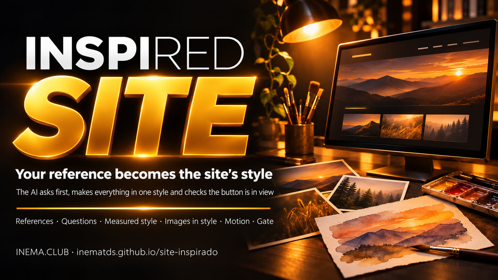

# site-inspirado

[](https://inematds.github.io/site-inspirado/guia/en/)

**🇧🇷 [Português](README.md) · 🇺🇸 [English](README.en.md) · 🇪🇸 [Español](README.es.md)**

## What it is

site-inspirado is a kit with a skill for Claude Code that creates websites that don’t look “AI-made.” You provide reference images (from Pinterest, a printed invitation, or a photo of your shop), and AI asks questions and researches before generating anything. Then it measures the style of those images, generates website images in the same style through Codex, and builds the page with transitions. Finally, an automated test checks whether the main button is visible and whether the page works on mobile. To use it, you need Claude Code, Codex signed in with your subscription, Python, and Node.

**A website that doesn’t look “AI-made.”** You provide 2 to 5 reference images (Pinterest, an
invitation you’ve already printed, a photo of the shop). The AI asks questions and researches before generating. All images
match the style of the references, the page gets code-based transitions, and a gate checks that
visitors can still find the button before you publish.

[Complete guide](https://inematds.github.io/site-inspirado/guia/en/)

Live pilots:
- **Event** (visual, fictional watercolor wedding): https://inematds.github.io/site-inspirado/pilotos/evento/
- **Bakery** (business, order button on the first screen): https://inematds.github.io/site-inspirado/pilotos/padaria/

## What’s included

| Piece | File | Does |
|---|---|---|
| Skill | `skill/site-inspirado/SKILL.md` | the 6 steps, with a gate at each one |
| Questions | `skill/site-inspirado/referencias/perguntas.md` | what to ask before generating, by site type |
| Measured style | `skill/site-inspirado/scripts/estilo.py` | references → measured palette, suggested roles with contrast, style prompt |
| Images | `skill/site-inspirado/scripts/imagens.py` | generates in the same style through Codex (image_gen, subscription, references attached), one at a time; contact sheet |
| Motion | `skill/site-inspirado/runtime/movimento.js` | reveal on scroll, parallax, opening veil, count-up; stops everything with “reduce motion” |
| Gate | `skill/site-inspirado/scripts/portao.js` | visual × conversion: CTA, errors, weight, mobile, reduce motion |
| Measure | `skill/site-inspirado/referencias/visual-x-conversao.md` | how much motion to use on a business or visual site |

## The process, from start to finish (8 steps)

🧠 = session with the person (uses tokens) · ⚙️ = script (zero tokens) · 🤖 = short `claude -p`

| # | Step | Command / what happens | Who |
|---|---|---|---|
| 1 | References | 2 to 5 images in `T/refs/` (Pinterest, invitation, shop photo) | person |
| 2 | Questions and research | the AI asks the questions in `perguntas.md`, researches what’s factual, and writes `T/BRIEF.md` with the type (`negocio` or `visual`) | 🧠 |
| 3 | Style | `python3 scripts/estilo.py T/refs T/estilo.json --prompt "<estilo>"` | ⚙️ + 🧠 (the prompt) |
| 4 | Image plan | `T/plano.json`: one line per image (subject, size) | 🧠 |
| 5 | Generate | `python3 scripts/imagens.py T/plano.json T/estilo.json T/img --refs T/refs` and view `T/img/folha.jpg` | ⚙️ |
| 6 | Page | `T/index.html` designed for the subject, `data-cta` on the button, `movimento.js` | 🧠 |
| 7 | Gate | `node scripts/portao.js T/index.html --tipo negocio --fotos T/fotos` → `PASSA` | ⚙️ |
| 8 | Publish | commit + push (GitHub Pages) or the client’s deployment | 🧠 |

Kit tests: `bash tests/rodar.sh` (style, gate on both pilots, and a bad page that must be blocked).

## Install the skill

```bash
ln -s "$PWD/skill/site-inspirado" ~/.claude/skills/site-inspirado
cd skill/site-inspirado/scripts && npm install && npx playwright install chromium   # only the gate needs it
```

Images: Codex CLI signed in to the subscription (`codex exec` with `image_gen`). Fallback: `--motor local` uses a
flux2-klein server at `$IMG_API` (default `http://localhost:8000`) — heavy on the machine. Animating the images into video (Kling, Magnific, and similar tools) is optional and requires authorization for that service; without it, all motion is code.

## How it differs from other INEMA kits

- **site-movimento**: the top becomes a continuous film that moves as you scroll.
- **filmarca**: turns an existing website into a brand film.
- **site-inspirado**: reference → measured style → original images → page with the button in view.

MIT License.